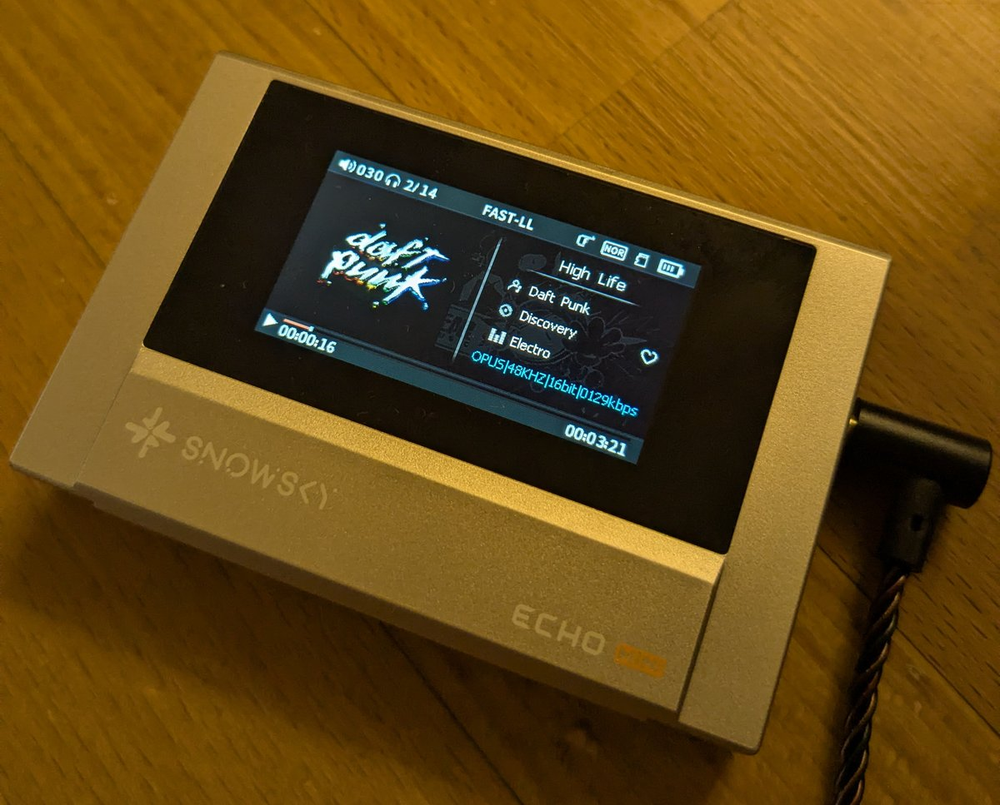

# Ogg Opus for the SNOWSKY ECHO MINI

This project adds **Ogg Opus (`.opus`)** playback to the SNOWSKY ECHO MINI digital audio player,
and improves the sound quality of **Ogg Vorbis (`.ogg`)** files. It patches the official
**V3.9.0** firmware (`HIFIEC39.IMG`, **8 GB model**). To make room for Opus, WMA support is
removed.

<p align="center">
  
</p>

**Status: validated on the device** (October 2026).

> ⚠️ **Disclaimer.** This is unofficial firmware patch. Flashing it may brick the device. A
> community MaskROM recovery procedure exists (see [Recovery](#recovery)) but was not tested by
> this project. Use at your own risk.
> This project is neither affiliated with nor endorsed by SNOWSKY.
> This is a one man project, mostly done with AI, tested on one device. You have been warned.

## What changes compared with the stock firmware
- **`.opus` files play**, with seeking, tags (title, artist, album, genre, track number), cover
  art, and "OPUS" on the playback screen. An Opus file named `.ogg` also plays.
- **`.ogg` Vorbis files sound better**: the stock decoder works at reduced precision, and is
  replaced by a full-precision one (see below).
- **WMA is no longer supported**: `.wma` files no longer appear in the browser.
- MP3, FLAC and the other formats are unchanged.

### Full-precision Ogg Vorbis
The stock Vorbis decoder is built in a **low-accuracy** mode: its output has roughly 7 effective
bits, and the added noise may be audible in quiet passages and fade-outs. This project replaces it
with the same decoder (Xiph's Tremor) at **full accuracy**, about as precise as a PC decoder,
for slightly less processing than the stock one. Tags, cover art and seeking work as before.

`HIFIEC58` also runs the audio core at the MP3 speed (300 MHz instead of 400–480 MHz) while
playing Ogg Vorbis, since the new decoder needs far less. Whether this saves battery has not been
measured.

### Which image?
| Image | Contents |
|---|---|
| **`HIFIEC58`** (recommended) | Opus + full-precision Vorbis, Ogg played at the MP3 clock speed. |
| `HIFIEC56` | Same decoders, stock clock speed for Ogg. |
| `HIFIEC52` | Opus only (stock Vorbis decoder). |
| `HIFIEC50` | Opus only, built with an unmodified libopus (reference build). |

### Known limits
- **8 GB model only** (`HIFIECxx.IMG`). The 512 MB model (`MINIVxx.IMG`) is not supported.
- The firmware looks for tags and cover art only at the very start of an Ogg file (about 4 KB).
  Long lyrics can push them out of reach. Workaround, without re-encoding:
  `ffmpeg -i in.opus -c copy -metadata LYRICS= out.opus`.
- The firmware never displays **progressive JPEG** cover art, whatever the audio format. For
  `.ogg` files, `tools/cover_baseline.py DIR --apply` re-encodes such covers as baseline JPEG
  (only the picture is rewritten; run it without `--apply` first, and keep a backup). Requires
  `mutagen` and `Pillow`.

## Installation
See **[INSTALL.md](INSTALL.md)**. In short: get the official `HIFIEC39.IMG`, then:
```
python3 patch/apply_patch.py apply HIFIEC39.IMG patch/HIFIEC58.ecpatch HIFIEC58.IMG
```
Then copy `HIFIEC58.IMG` **alone** to the root of the internal storage and reboot. Ready-made
patches are also attached to each [release](https://github.com/berettavexee/echo-mini-opus/releases).

## Recovery
If an update goes wrong but the player still boots, install the back-to-stock image (see
`INSTALL.md`, section 4).

If the player no longer boots at all (black screen), the community documents a low-level
recovery through the Rockchip **MaskROM** mode: the player is put into MaskROM with the reset
button, then a stock firmware image is written over USB with `rkdeveloptool`. See
**[livetrack.club/debrick](https://livetrack.club/debrick)**. This procedure was **not tested by
this project**; follow it at your own risk.

## For developers
- **[docs/BUILDING.md](docs/BUILDING.md)**: building the images from source (bit-identical to
  the patches), off-device validation, repository layout.
- **[docs/OPUS_PORTING.md](docs/OPUS_PORTING.md)** and
  **[docs/TREMOR_PORTING.md](docs/TREMOR_PORTING.md)**: how the decoders were fitted into the
  firmware, optimised and validated, with checklists for other players.
- **[docs/REPORT.md](docs/REPORT.md)**: the reverse-engineering report.
- **[docs/IMAGE_HISTORY.md](docs/IMAGE_HISTORY.md)**: history of the test images.

## Acknowledgments
More ambitious custom firmware projects exist for this player, and are worth a look:
- **[RECHO](https://recho.atzkey.workers.dev/)** by atzkey: a from-scratch firmware for the ECHO
  MINI (gapless playback, improved navigation, files in name order).
- **[ReChord](https://github.com/brnomt/ReChord)**: a from-source custom firmware for the ECHO
  MINI, in progress.

This project is independent from both and shares no code with them (but I will be happy to share).

## License
- This project's code: BSD-3-Clause (`LICENSE`).
- libopus and Tremor: BSD-3-Clause, see `THIRD_PARTY.md` and `LICENSES/`. The patches to them are
  distributed under the same license.
- The SNOWSKY firmware is not distributed.
